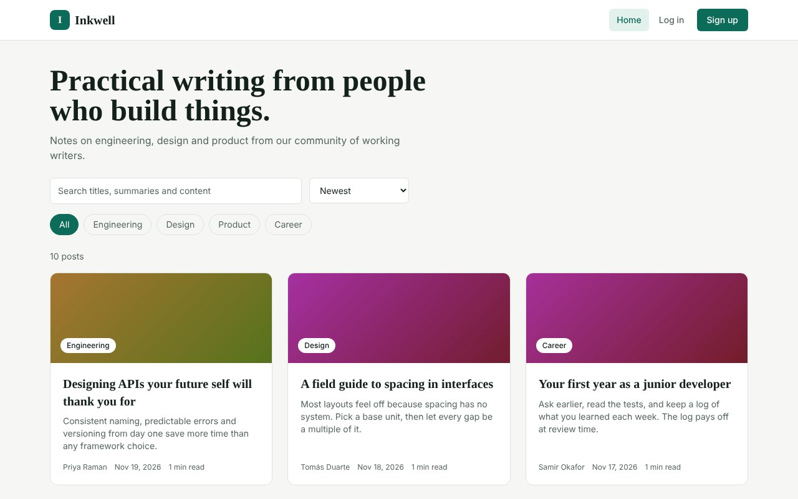
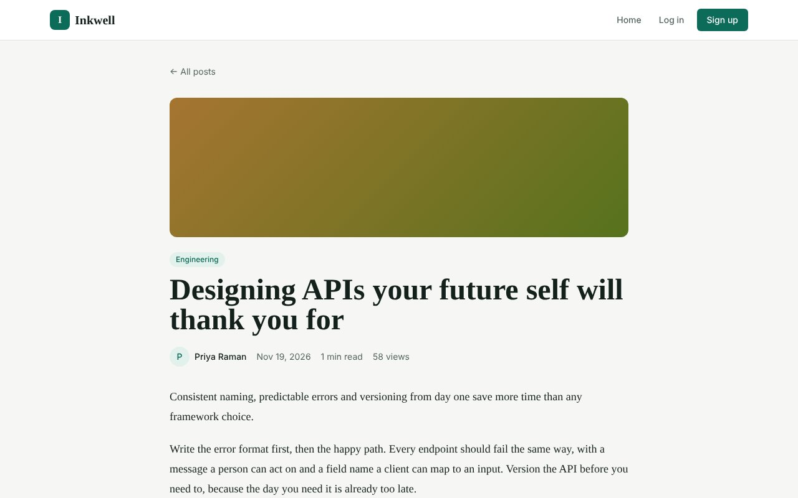
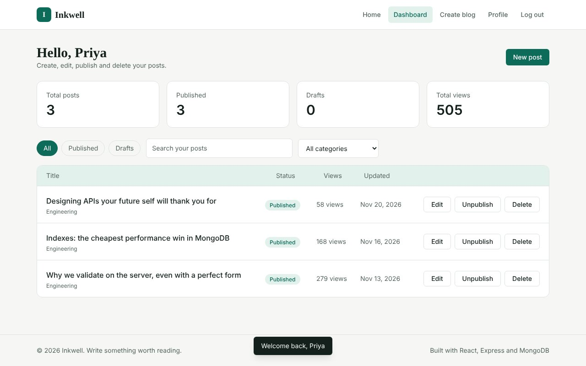
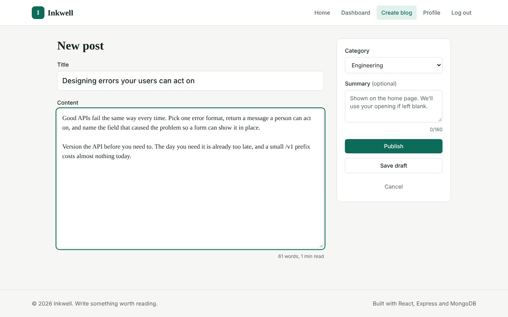
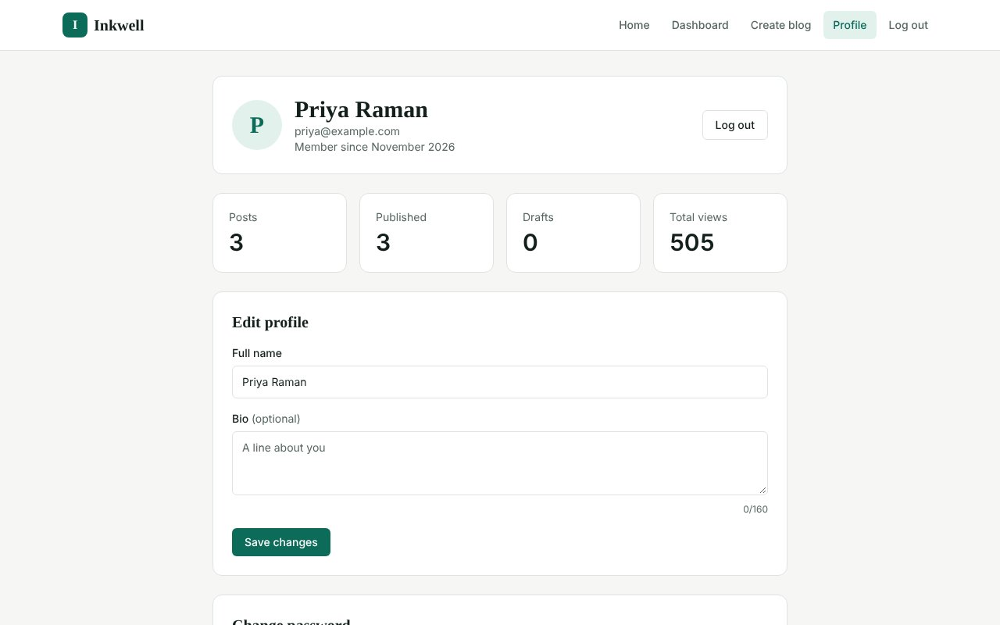
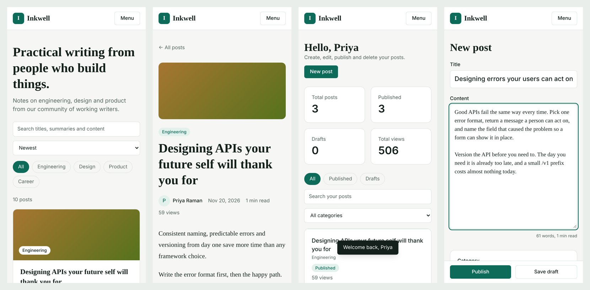
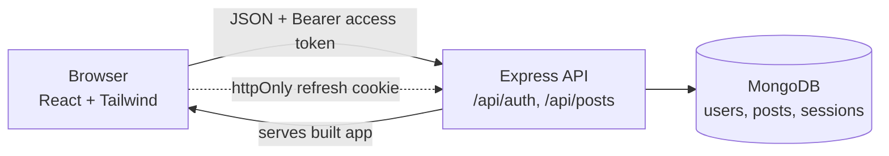

# Inkwell

**A full stack blog platform where people write, publish and discover posts on engineering, design and product.**

Built with React, Express and MongoDB. Features secure token-based authentication, full post CRUD, private dashboards, a profile page with session management, and a responsive UI that works from phones to desktops.

[](https://github.com/mahbubovi/inkwell/actions/workflows/ci.yml)


**Live demo:** https://YOUR-APP.vercel.app &nbsp;|&nbsp; **Repository:** https://github.com/mahbubovi/inkwell



## Features

- **Authentication.** Register and log in. A short-lived JWT access token (kept in memory) is paired with a rotating refresh token in an httpOnly cookie. Passwords are hashed with bcrypt.
- **Full CRUD for posts.** Create, read, update and delete. Drafts, publish and unpublish, and owner-only access enforced on the server.
- **Private dashboard.** Lists only the logged-in user's posts, with stats, search, status and category filters.
- **Discovery.** Public feed with search across titles, summaries and content, category filters, sorting, pagination, and shareable filter URLs.
- **Blog pages.** A page per post with author, read time, view count, related posts and a copy-link button. Authors can preview their own drafts.
- **Profile.** Edit name and bio, change password, and see or end sessions on other devices.
- **Responsive and accessible.** Mobile-first layout, sticky save bar on phones, skeleton loaders, dark mode, keyboard focus styles and a skip link.
- **Production ready.** Content Security Policy, rate limiting, gzip, long-lived asset caching, health check, graceful shutdown and CI.

| Feed and filters | Blog page |
|---|---|
|  |  |
| **Dashboard** | **Editor** |
|  |  |
| **Profile and sessions** | **Mobile** |
|  |  |

## Tech stack

| Layer | Tools |
|---|---|
| Frontend | React 19, React Router, Tailwind CSS, Vite |
| Backend | Node.js, Express 5, Mongoose |
| Database | MongoDB (local or Atlas) |
| Security | JWT, bcrypt, httpOnly cookies, Helmet (CSP), express-rate-limit, express-validator |
| Quality | Node test runner integration tests, GitHub Actions CI |
| Deployment | Vercel (website and API as a serverless function), or Render |

## Architecture



In production one Express service serves both the API and the built React app, so the browser talks to a single origin and the login cookie stays first-party.

## Project structure

```
inkwell/
├── client/                 React app (Vite + Tailwind)
│   └── src/
│       ├── components/     Navbar, PostCard, Field, Skeleton, ErrorBoundary, route guards
│       ├── context/        AuthContext, ToastContext
│       ├── lib/            api.js (fetch wrapper with silent token refresh), utils.js
│       └── pages/          Home, PostDetail, Login, Register, Dashboard, CreatePost, Profile
├── server/                 Express API
│   ├── src/                config, models, controllers, routes, middleware, seed.js
│   └── test/               API integration tests
├── docs/                   DEPLOYMENT.md, screenshots, LinkedIn drafts
├── api/index.js            Vercel serverless entry point (wraps the Express app)
├── vercel.json             Vercel build, routing and security headers
├── render.yaml             Render blueprint (alternative host)
└── .github/workflows/      CI (tests and build)
```

## Getting started

You need Node.js 22 (LTS) and a MongoDB database: a local install, Docker (`docker run -d -p 27017:27017 --name mongo mongo:7`), or a free [MongoDB Atlas](https://www.mongodb.com/atlas) cluster.

```bash
git clone https://github.com/mahbubovi/inkwell.git
cd inkwell
npm install                       # installs the dev runner
npm --prefix server install
npm --prefix client install

cp server/.env.example server/.env   # then set MONGO_URI and JWT_SECRET
npm run seed                         # optional: sample authors and 10 posts (password: secret123)
npm run dev                          # API on :5000, web app on http://localhost:5173
```

On Windows PowerShell use `copy server\.env.example server\.env`.

### Scripts

| Command | What it does |
|---|---|
| `npm run dev` | Starts the API and the Vite dev server together |
| `npm run build` | Installs dependencies and builds the React app into `client/dist` |
| `npm start` | Starts the API, which also serves `client/dist` |
| `npm run seed` | Adds sample users and posts (`--reset` after `--` wipes first) |
| `npm test` | Runs the API integration tests (needs MongoDB on `127.0.0.1:27017`) |

### Environment variables

| Variable | Required | Purpose |
|---|---|---|
| `MONGO_URI` | Yes | MongoDB connection string |
| `JWT_SECRET` | Yes | Signs access tokens. At least 32 characters in production |
| `PORT` | No | Default `5000` |
| `ACCESS_TOKEN_EXPIRES` | No | Access token lifetime, default `15m` |
| `REFRESH_TOKEN_DAYS` | No | Session length, default `7` |
| `COOKIE_SAMESITE` | No | `lax` (default) or `none` when the frontend is on a different site |
| `CLIENT_URL` | No | Comma-separated origins allowed to call the API directly |
| `SEED_PASSWORD` | No | Password for the sample accounts created by `npm run seed` |
| `NODE_ENV` | No | `production` turns on Secure cookies, HSTS and proxy trust |
| `VITE_API_URL` | No (client) | API base URL when the client is hosted separately |

## API reference

Base URL `/api`. Protected routes need `Authorization: Bearer <access token>`.

| Method | Endpoint | Auth | Purpose |
|---|---|---|---|
| POST | `/auth/register` | No | Create an account, returns `{ user, token }` and sets the refresh cookie |
| POST | `/auth/login` | No | Log in |
| POST | `/auth/refresh` | Cookie | New access token, rotates the refresh cookie |
| POST | `/auth/logout` | Cookie | End this device's session |
| POST | `/auth/logout-all` | Yes | End every session |
| GET | `/auth/me` | Yes | Current user |
| GET / PATCH | `/auth/profile` | Yes | Read profile and stats / update name and bio |
| PATCH | `/auth/password` | Yes | Change password (ends other sessions) |
| GET | `/auth/sessions` | Yes | Devices you are logged in on |
| DELETE | `/auth/sessions/:id` | Yes | Sign out one device |
| GET | `/posts?q=&category=&sort=&page=&limit=` | No | Published posts, paginated: `{ posts, total, page, pages }` |
| GET | `/posts/mine` | Yes | Your posts, drafts included |
| GET | `/posts/:id` | No | A published post plus related posts. A draft is returned only to its author |
| POST | `/posts` | Yes | Create a post |
| PUT | `/posts/:id` | Yes | Update your post |
| PATCH | `/posts/:id/status` | Yes | Publish or unpublish (publishing needs at least 50 words) |
| DELETE | `/posts/:id` | Yes | Delete your post |
| GET | `/health` | No | Health check including database status |

Validation errors return `422` with `{ message, errors: { field: message } }`.

## Authentication design

| Part | How it works |
|---|---|
| Access token | JWT valid for 15 minutes, sent as a Bearer token. Held in browser memory only, never in localStorage |
| Refresh token | Random string in an httpOnly cookie that JavaScript cannot read. Scoped to `/api/auth`, valid for 7 days, rotated on every use |
| Session storage | The database stores only a SHA-256 hash of the refresh token, so sessions can be listed and revoked, and a leaked database cannot be used to log in |
| Silent refresh | An expired access token is refreshed once and the request retried, so users are not logged out mid-task |
| Reuse detection | An old refresh token presented after a short grace period ends that session |
| Password change / sign out everywhere | Ends sessions and bumps a `tokenVersion` on the user, so every earlier access token is rejected immediately |
| Brute force | 20 failed login or register attempts per 15 minutes per IP (counted per server instance, so on serverless hosting use a shared store such as Redis if you need strict limits) |
| Private data | `GET /posts/mine` filters by the id inside the token. Edit and delete queries include the author, so another user's request gets a 404 |

## Database design

| Collection | Key fields | Notes |
|---|---|---|
| `users` | `name`, `email` (unique), `bio`, `password`, `tokenVersion` | Passwords are bcrypt hashes (cost 12) and excluded from queries by default |
| `posts` | `title`, `body`, `excerpt`, `category`, `status`, `views`, `readMinutes`, `author` | Indexes on `{ status, createdAt }` and `author` |
| `sessions` | `user`, `tokenHash` (unique), `prevTokenHash`, `userAgent`, `expiresAt` | One document per device. A TTL index removes expired sessions |

## Testing

```bash
npm test
```

Nine integration tests cover registration, login, token refresh and rotation, logout, post CRUD with draft privacy and ownership rules, dashboard isolation, search, sorting and pagination, and password changes. They run on every push through GitHub Actions.

## Deployment

The project deploys to **Vercel** with a free MongoDB Atlas database: Vercel serves the React build and runs the Express API as a serverless function, so the whole app lives at one URL. A `render.yaml` blueprint is included as an alternative. See **[docs/DEPLOYMENT.md](docs/DEPLOYMENT.md)** for step-by-step instructions and troubleshooting.

## Roadmap

- Comments and likes
- Rich text or Markdown editor with image upload
- Email verification and password reset
- Tags and author pages

## License

MIT. See [LICENSE](LICENSE).

Built by [@mahbubovi](https://github.com/mahbubovi).
